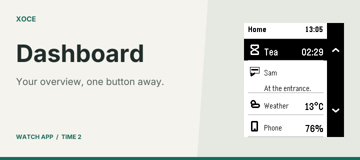

# Dashboard

A current activity, the latest available notification and two configurable pins in one overview.



[Artwork provenance](store/artwork-provenance.json). Native emulator example capture.

## Download

**Dashboard 1.0.2 is published in [Pebble Store](https://apps.repebble.com/603d814e961c40308c98ce63).**
The [product page](https://xefensor.github.io/xoce/projects/dashboard/) provides installation, setup, support and privacy links.

Matching [GitHub release v1.0.2](https://github.com/xefensor/pebble-app-dashboard/releases/tag/v1.0.2):

- [PBW](https://github.com/xefensor/pebble-app-dashboard/releases/download/v1.0.2/Dashboard-1.0.2.pbw)
- [Source](https://github.com/xefensor/pebble-app-dashboard/releases/download/v1.0.2/Dashboard-1.0.2-source.zip)
- [Debug files](https://github.com/xefensor/pebble-app-dashboard/releases/download/v1.0.2/Dashboard-1.0.2-debug.zip)
- [Checksums](https://github.com/xefensor/pebble-app-dashboard/releases/download/v1.0.2/SHA256SUMS.txt)

Install one PBW through the Pebble phone app. It includes the watchapp and its phone-side components; no separate library installation is needed. Earlier releases remain available in [release history](https://github.com/xefensor/pebble-app-dashboard/releases).

## Compatibility

The published release targets **Pebble Time 2 / Emery** and **Round 2 / Gabbro**, built with **Pebble SDK 4.44**. Duo is excluded.

Sharing readings and activities needs plugin support in the official Pebble phone app, the permissions required by your sources and a connected phone. Built-in music and notifications require Android.

## Setup and use

Choose your activity sources and pins in the phone settings. Each pin has separate reading, Select action and Hold Select destination choices. Tap Select for an available action and hold Select for its associated app. Hold Up or Down from Snapshot to browse Activities or Pinned. Dashboard does not pause or resume Timer; open Timer to change its countdown.

[Usage and controls](docs/USAGE.md) · [Current UI](docs/UI.md) · [Troubleshooting and support](SUPPORT.md).

## Activities: see what is happening now

Activities are updates about something happening now, such as a countdown, music or a notification. Compatible XOCE products decide how to display them.

Start a countdown in Timer and open Dashboard to see its activity in the overview. Hold Up to browse available activities. Dashboard has its own source order and visibility choices, separate from either watchface. Available actions depend on the selected source.

Weather and battery readings use separate reading settings. Open Activity is optional; an app can always be opened from the watch's app list.

## Display settings and languages

The phone settings provide **Text Size** and **Light/Dark** watch appearance. Follow Pebble text size uses the watch's preference. Automatic Follow Pebble appearance is unavailable in this build; the page explains the saved Light/Dark fallback. Phone-page appearance follows the phone independently.

A confirmed Save means the choices were stored on the phone. Pending watch delivery and Applied on watch are separate states. Saving stays open on the supported embedded settings route; the legacy return-URL route follows its documented closing behaviour.

The release supports English, Czech, Slovak, German, French, Spanish, Italian, Portuguese, Dutch, Polish, Danish, Swedish, Norwegian, Finnish, Hungarian, Romanian and Turkish. Unsupported languages use English. Provider text, user labels and saved bindings keep their original values.

## Verification scope

[Release readiness](docs/RELEASE-READINESS.md) links the version-bound source, package and emulator evidence. Publication is complete; no physical phone/watch or live-provider result is implied by that status. Earlier captures retain their actual versions and provenance.

## Development

Use the pinned Node 22.23.4 and Python 3.12.15 runtimes and a C compiler. Native builds additionally need Pebble SDK 4.44; the [contributor guide](CONTRIBUTING.md) documents its isolated bootstrap.

```sh
npm ci --ignore-scripts
npm test
npm run build
npm run check:artifact
```

[Contributor guide](CONTRIBUTING.md) · [Release workflow](docs/RELEASING.md) · [History index](docs/history/index.md).
Development outputs belong in ignored `build/`; published archives stay frozen. The current bundled UI package is 0.1.3; Activities is bundled at 0.4.5.

## Licence

[PolyForm Noncommercial 1.0.0](LICENSE). Preserve [third-party notices](THIRD-PARTY-NOTICES.md) and attribution. See [privacy](PRIVACY.md) for app-owned data handling.

## Earlier release notes

<span id="store-update-101"></span>

<span id="version-063"></span>

<span id="version-100--stable-release-preparation"></span>

The earlier Store-update preparation, development download and version notes remain in the [README snapshot before this documentation refresh](https://github.com/xefensor/pebble-app-dashboard/blob/415410e782b5aedbb9cfa03724aedc5dab785305/README.md). Those notes describe their original versions and evidence, not the current installation.
